# PE File - Tệp thực thi khả chuyển
## Giới thiệu
PE là viết tắt cho từ Portable Executable (hay tạm dịch là tệp thực thi khả chuyển), là định dạng file thực thi chuẩn trên Windows. Các file mà có phần đuôi mở rộng như: `.exe`, `.com`, `.dll`, `.sys`, `.acm`, `.ax`, `.cpl`, `.drv`, `.efi`, `.ime`, `.mui`, `.ocx`, `.scr`, `.tsp`, `.msstyles` đều là các file PE. Sở dĩ chúng ta gọi nó là PE (tệp thực thi khả chuyển) nhằm phản ánh tính linh hoạt của định dạng này trong việc hỗ trợ nhiều nền tảng phần cứng, mặc dù nó chủ yếu được sử dụng trên Windows. Định dạng PE được xây dựng dựa trên định dạng COFF (Common Object File Format) và cũng là nền tảng cho định dạng thực thi trong .NET (tức .NET PE). Một file PE là cấu trúc dữ liệu mô tả cấu trúc cần thiết để hệ điều hành có thể tải và thực thi chương trình, bao gồm thông tin về mã máy, dữ liệu, thư viện cần thiết, và thông tin định vị các thành phần bên trong tệp.

Một file PE có cấu trúc tổng quát như sau:
```
+----------------------------------+
| IMAGE_DOS_HEADER                 |
| "MZ"                             |
| e_lfanew --------------------+   |
+------------------------------|---+
| DOS Stub                     |   |
+------------------------------|---+
                               |
                               v
+----------------------------------+
| PE Signature                     |
| "PE\0\0"                         |
+----------------------------------+
| IMAGE_FILE_HEADER                |
| (COFF Header)                    |
+----------------------------------+
| IMAGE_OPTIONAL_HEADER            |
| - EntryPoint                     |
| - ImageBase                      |
| - SectionAlignment               |
| - FileAlignment                  |
| - DataDirectory[]                |
+----------------------------------+
| IMAGE_SECTION_HEADER[]           |
| Section Table                    |
+----------------------------------+
| .text                            |
+----------------------------------+
| .rdata                           |
+----------------------------------+
| .data                            |
+----------------------------------+
| .idata                           |
+----------------------------------+
| .rsrc                            |
+----------------------------------+
| .reloc                           |
+----------------------------------+
| ...                              |
+----------------------------------+
```

Hoặc ta có ảnh này:

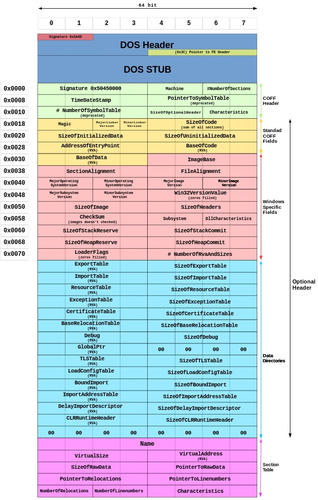
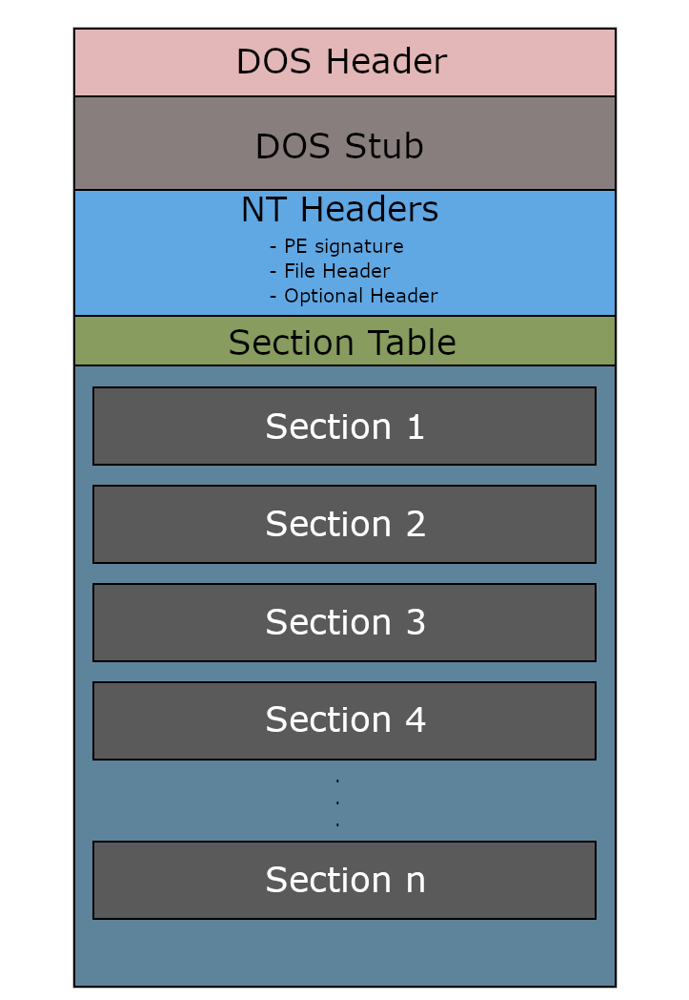

Còn nếu muốn chi tiết hơn thì ta có thể sử dụng công cụ `PE Bear` để đọc phần bên trong của một file PE, và khi đó ta cũng sẽ thấy điều tương tự giống như thế này:

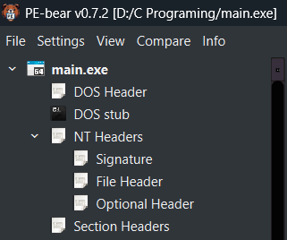

Vậy một file PE dùng để làm gì? Ví dụ khi ta viết code C có dạng như này:
```c
#include <stdio.h>

int main()
{
    printf("Hello World\n");
    return 0;
}
```

Khi compile trên Windows bằng lệnh `gcc main.c -o main.exe` thì ta sẽ nhận về một file thực thi có dạng là `main.exe`. Và đó chính là file PE trên Windows. Trong file đó không chỉ chứa machine code của main(), mà còn chứa rất nhiều thông tin giúp Windows Loader biết:
- File dành cho x86 hay x64.
- Chương trình bắt đầu chạy ở đâu.
- Cần load DLL nào.
- Cần import những API nào.
- Code nằm ở đâu.
- Data nằm ở đâu.
- Resource/icon nằm ở đâu.
- Nếu ImageBase thay đổi thì cần relocation như thế nào.
- Quyền của từng vùng memory là R, W, X như thế nào.

Về cơ bản là khi ta có được một file `main.exe` và double-click vào đó thì Windows không đơn giản lấy toàn bộ file rồi nhảy vào byte đầu tiên, mà thay vào đó, Windows loader sẽ đọc PE header để biết:
```
File này có phải PE không?
        ↓
Chạy trên x86 hay x64?
        ↓
Cần map bao nhiêu memory?
        ↓
.text nằm ở đâu?
.data nằm ở đâu?
        ↓
Entry Point ở đâu?
        ↓
Cần load DLL nào?
        ↓
Cần resolve API nào?
        ↓
Có relocation không?
        ↓
Thiết lập memory permission
        ↓
Jump tới Entry Point
```

Vì vậy có thể xem PE Header là "bản hướng dẫn để Windows load chương trình". Bây giờ ta sẽ tìm hiểu về một vài thành phần của file PE.


## Các thành phần cơ bản
### IMAGE_DOS_HEADER
Mở đầu một file PE ta có một cấu trúc gọi là IMAGE_DOS_HEADER, hay ta có thể gọi nó là DOS header hoặc MS-DOS Header. Đây là một cấu trúc dài 64-byte nằm ở phần đầu của file PE. Một số field trong phần header này không còn quan trọng đối với chức năng của file PE trên các hệ thống Windows hiện đại. Tuy nhiên, nó vẫn tồn tại vì lý do tương thích ngược. Header này giúp file có thể được nhận diện như một file thực thi MS-DOS. Vì vậy, khi file được chạy trên MS-DOS, DOS Stub sẽ được thực thi thay vì chương trình Windows thực sự. Nếu không có header này, khi bạn cố gắng chạy file thực thi đó trên MS-DOS, nó sẽ không được nạp và chỉ tạo ra một lỗi chung chung.

> MS-DOS là viết tắt của Microsoft Disk Operating System - một hệ điều hành dòng lệnh của Microsoft, rất phổ biến trên máy tính IBM PC và tương thích trong thập niên 1980-1990. Nó khác Windows hiện đại ở chỗ không có giao diện đồ họa kiểu cửa sổ như ta quen dùng. Người dùng chủ yếu làm việc bằng command line, ví dụ:
>```
>C:\> dir
>C:\> cd DOS
>C:\DOS> edit file.txt
>C:\> program.exe
>```
> MS-DOS chạy chủ yếu trên kiến trúc x86 đời cũ, trong môi trường 16-bit, và các chương trình thường là `.COM` hoặc `.EXE`. Nói một cách dễ hiểu thì MS-DOS là hệ điều hành tiền thân quan trọng trong lịch sử PC, còn DOS Header/DOS Stub trong PE là di sản để giữ tương thích với thời đó.


Về bản chất thì thực ra IMAGE_DOS_HEADER là tên struct chính thức trong Windows headers. Khi tìm hiểu trong file `winnt.h` (nằm ở trong đường dẫn `C:\Program Files (x86)\Windows Kits\10\Include\<version>\um\winnt.h`) thì ta sẽ thấy struct của IMAGE_DOS_HEADER có dạng như sau:
```c
typedef struct _IMAGE_DOS_HEADER {      // DOS .EXE header
    WORD   e_magic;                     // Magic number
    WORD   e_cblp;                      // Bytes on last page of file
    WORD   e_cp;                        // Pages in file
    WORD   e_crlc;                      // Relocations
    WORD   e_cparhdr;                   // Size of header in paragraphs
    WORD   e_minalloc;                  // Minimum extra paragraphs needed
    WORD   e_maxalloc;                  // Maximum extra paragraphs needed
    WORD   e_ss;                        // Initial (relative) SS value
    WORD   e_sp;                        // Initial SP value
    WORD   e_csum;                      // Checksum
    WORD   e_ip;                        // Initial IP value
    WORD   e_cs;                        // Initial (relative) CS value
    WORD   e_lfarlc;                    // File address of relocation table
    WORD   e_ovno;                      // Overlay number
    WORD   e_res[4];                    // Reserved words
    WORD   e_oemid;                     // OEM identifier (for e_oeminfo)
    WORD   e_oeminfo;                   // OEM information; e_oemid specific
    WORD   e_res2[10];                  // Reserved words
    LONG   e_lfanew;                    // File address of new exe header
  } IMAGE_DOS_HEADER, *PIMAGE_DOS_HEADER;
```

Cấu trúc này rất quan trọng đối với file thực thi trên MS-DOS, tuy nhiên thì hiện tại trong cấu trúc này chỉ còn có một vài phần thật sự là quan trọng mà ta cần lưu ý trong hệ thống máy tính hiện đại. Hai field quan trọng nhất trong struct này là:
- `e_magic`: Đây là phần đầu tiên của DOS Header, mang kiểu dữ liệu là WORD nên nó sẽ chiếm 2-byte. Đối với các loại file ảnh như PNG, JPG, hay âm thanh như MP3, MP4, hoặc tệp nén như ZIP, RAR, … đều có định dạng riêng. Để có thể phân biệt và nhận diện các loại file, người ta sẽ dùng phần đầu để xác định, gọi là header. Trong phần header này có chứa 1 dãy byte, gọi là magic byte, đóng vai trò như signature (chữ ký) của file đó. Ví dụ như đối với file ảnh PNG ta có magic byte như sau:

    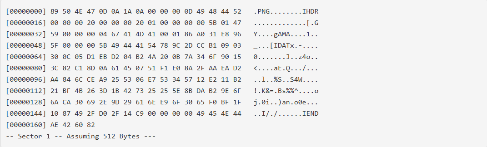

    Có thể thấy 8 byte hex đầu tiên là `89 50 4E 47 0D 0A 1A 0A` chính là magic byte của file PNG, và dựa vào đó mà hệ điều hành có thể đọc và hiểu đó là một file ảnh để có thể hiển thị lên cho người xem.

    File PE cũng như vậy, nó cũng có cho mình một magic byte để hệ điều hành có thể xác nhận đây là một tệp thực thi trên Windows. Magic byte của nó nằm ở offset 0x00 và có dạng là `4D 5A`, hay là byte "MZ" như này:

    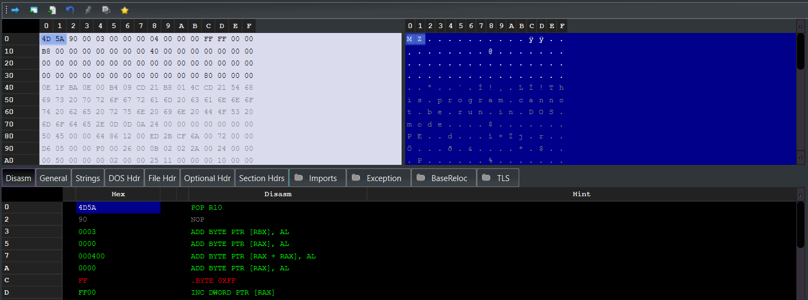

    Tên "MZ" ở đây đến từ Mark Zbikowski, một kỹ sư Microsoft thời DOS. Trên thực tế thì đây là magic byte có từ thời DOS, nó không phải là đại diện cho magic byte của file PE hiện đại.

- `e_lfanew`: Đây là phần cuối cùng trong cấu trúc DOS Header và là field cực kỳ quan trọng. Nó nằm ở offset 0x3C tính từ đầu file. Vai trò của nó là chứa một offset trỏ tới điểm bắt đầu của NT headers, giúp cho loader biết cần tìm file header ở đâu. Ví dụ:

    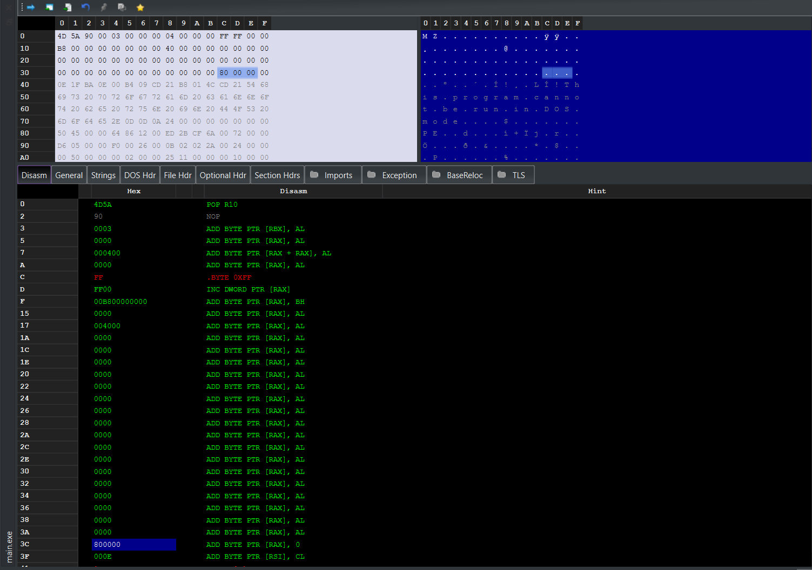

    Hoặc:

    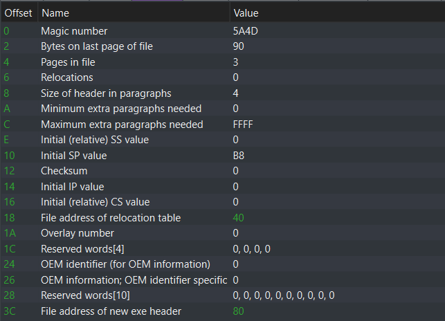
    
    Như trong ví dụ trên, tại offset `0x3C` đang chứa giá trị là 80. Đó chính là offset điểm bắt đầu của NT headers. Khi ta tới offset `0x80` thì ta sẽ có:

    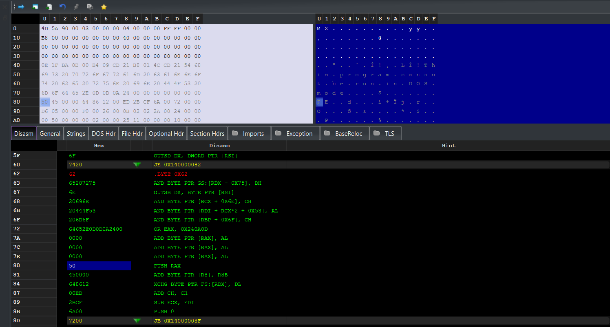

    Tại đây, nó đang chứa chuỗi ký tự hex là `50 45 00 00`, hay ASCII là `P E \0 \0`. Ta có thể hình dung quá trình đó qua sơ đồ:
    ```
    main.exe
    │
    ├── 0x0000
    │     MZ
    │
    ├── ...
    │
    ├── 0x003C
    │     e_lfanew = 0x000000F8
    │
    │
    └── 0x00F8
        PE 00 00
    ```
    Chuỗi kí tự đó ta gọi nó là PE signature. Cần phải lưu ý rằng tại đầu file PE, field `e_magic` chứa giá trị MZ, tương ứng hai byte `4D 5A`. Giá trị này cho biết file bắt đầu bằng một MZ executable header. Tuy nhiên, MZ không đủ để xác nhận file là PE, bởi các executable DOS cũ cũng có thể sử dụng chữ ký này. Để xác nhận một PE file, parser cần đọc `e_lfanew`, đi tới NT Headers và kiểm tra PE signature `50 45 00 00 (PE\0\0)`.


### DOS Stub
DOS Stub là một chương trình MS-DOS in ra thông báo lỗi cho biết file thực thi không tương thích với DOS, rồi thoát. Đây là phần được thực thi khi chương trình được nạp trên MS-DOS. Thông báo lỗi mặc định là `This program cannot be run in DOS mode.`, tuy nhiên thông báo này có thể được người dùng thay đổi lúc biên dịch.

Ví dụ như này:

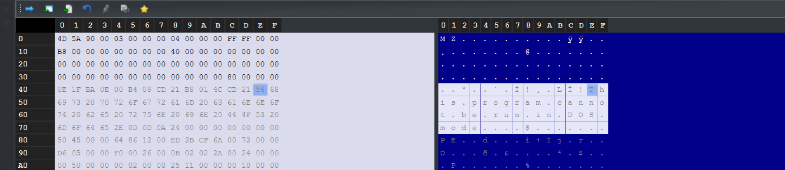

Nó nằm ngay sau IMAGE_DOS_HEADER (từ offset `0x40`) đến trước `PE\0\0`. Đây là lý do e_lfanew thường > 0x40. Về bản chất thì nó là code 16-bit thật, thường chỉ khoảng 14 byte lệnh + chuỗi thông báo, kết thúc bằng $ (theo quy ước của hàm in chuỗi `int 21h / AH=09h`). Đó là tất cả những gì chúng ta cần biết về DOS Stub, chúng ta sẽ không thực sự quan tâm đến nó vì nó chỉ đơn giản là in ra lỗi khi file thực thi không tương thích với DOS.


### Rich Header
Đó là về phần DOS HEADER và DOS Stub. Bên cạnh hai vùng dữ liệu đáng nói ở trên thì chúng ta vẫn còn một vùng dữ liệu khác ít được nhắc tới hơn. Vùng này nằm ở giữa cả hai và chỉ có trong các file thực thi được xây dựng bằng MSVC (Microsoft Visual Studio - Visual Tím). Đó là phân vùng Rich Header. Về cơ bản thì phân vùng này chứa các metadata về các công cụ được sử dụng để xây dựng nên file thực thi, chẳng hạn như tên hoặc loại của chúng, cũng như phiên bản và số bản dựng cụ thể. Đa số các tài liệu về cấu trúc file PE ít đề cập đến khối dữ liệu này, nhưng nếu ta tìm kiếm cụ thể "Rich Header" thì nó sẽ ra rất nhiều tài liệu có liên quan đến nó. Điều này cũng khá là dễ hiểu vì về bản chất Rich Header không phải là một phần của cấu trúc file PE mà chỉ là phần dữ liệu được MSVC thêm vào khi ta xây dựng các file thực thi bằng công cụ đó. Do vậy chúng ta hoàn toàn có thể xoá bỏ hoặc thay đổi nó mà không làm ảnh hưởng đến khả năng thực thi của file, miễn là không sửa vào các vị trí quan trọng khác của file là được. 

Ví dụ ta có một đoạn code C như này:
```c
#include <stdio.h>

int main()
{
    printf("Hello World\n");
    return 0;
}
```

Khi compile đoạn code trên bằng GCC của MSYS2 với lệnh `gcc main.c -o main1` thì ta sẽ thu được một file `.exe` như này:
```
D:\C2PE>dir
 Volume in drive D is Study
 Volume Serial Number is 5678-EDE1

 Directory of D:\C2PE

18/10/2026  08:30 CH    <DIR>          .
15/10/2026  03:15 CH                78 main.c
               1 File(s)             78 bytes
               1 Dir(s)   3.167.129.600 bytes free

D:\C2PE>gcc main.c -o main1

D:\C2PE>dir
 Volume in drive D is Study
 Volume Serial Number is 5678-EDE1

 Directory of D:\C2PE

18/10/2026  08:32 CH    <DIR>          .
15/10/2026  03:15 CH                78 main.c
18/10/2026  08:32 CH            63.344 main1.exe
               2 File(s)         63.422 bytes
               1 Dir(s)   3.167.064.064 bytes free

D:\C2PE>
```

Khi mở file đó trong PE Bear thì ta có thể thấy như này:

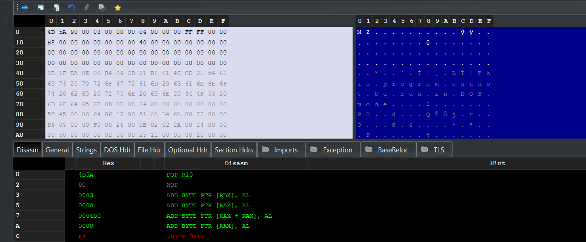

Ở hàng các ô như Disasm, General,... thì sẽ không có phần dữ liệu của Rich Header. Còn khi compile source code trên bằng Visual tím như thế này thì ta sẽ có:

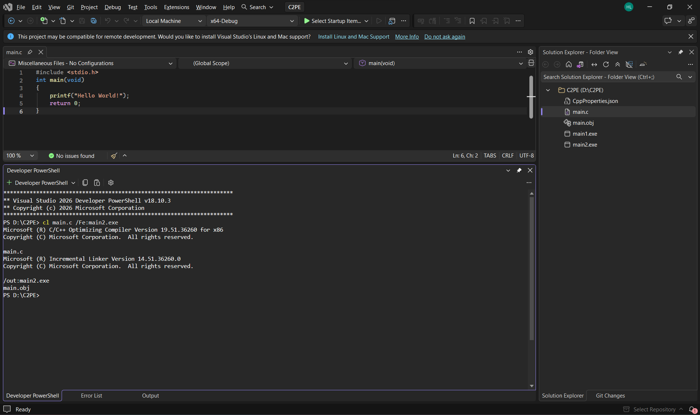

Mở trong PE Bear, ta có được:

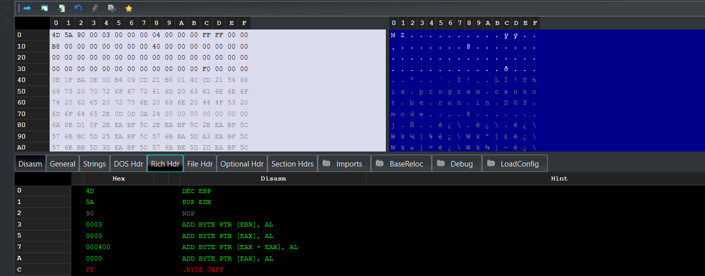


Có một câu chuyện rất hay về Rich Header là vào năm 2018 tại XXIII Olympic Winter Games, một nhóm các hacker đã tấn công vào hệ thống CNTT của sự kiện bằng một con Malware có tên là Olympic Destroyer, gây ra một số thiệt hại như: Website chính thức của Olympic bị gián đoạn, ảnh hưởng đến việc in vé, hệ thống Wi-Fi và một số dịch vụ truyền hình tại địa điểm tổ chức gặp sự cố, nhiều máy tính và máy chủ bị xóa dữ liệu khiến hệ thống không thể hoạt động bình thường. Malware này thuộc loại Wiper, tức là mã độc được thiết kế để phá hủy dữ liệu, khác với ransomware vốn thường mã hóa dữ liệu để đòi tiền chuộc. Điều khiến vụ án trở nên đặc biệt không chỉ là sức phá hoại mà còn là việc hacker cố tình để lại những dấu vết kỹ thuật gây hiểu lầm về danh tính của mình.

Cụ thể thì nhóm nghiên cứu GReAT của Kaspersky phát hiện một điều rất bất thường khi phân tích thành phần Wiper (resource 105) trong Olympic Destroyer. Rich Header của nó trùng khớp chính xác với Rich Header của một malware thuộc Lazarus Group, cụ thể là mẫu BlueNoroff. Không chỉ có Rich Header, cả vùng MZ DOS Header của hai mẫu cũng giống nhau. Điều này ban đầu khiến các chuyên gia nghi ngờ cả hai được xây dựng từ cùng môi trường phát triển. Tuy nhiên, nhà nghiên cứu Igor Soumenkov đã kiểm tra sâu hơn và phát hiện sự mâu thuẫn rất rõ ràng. Về chi tiết thì bạn có thể đọc thêm bài báo của Kaspersky **[ở đây](https://securelist.com/the-devils-in-the-rich-header/84348/)**.

Về cấu trúc của Rich Header thì nó là một khối dữ liệu đã được XOR hoá, tức là kết quả mà ta thấy được khi dùng PE Bear hoặc các công cụ khác để xem thì nó sẽ là một chuỗi hex vô nghĩa như này:

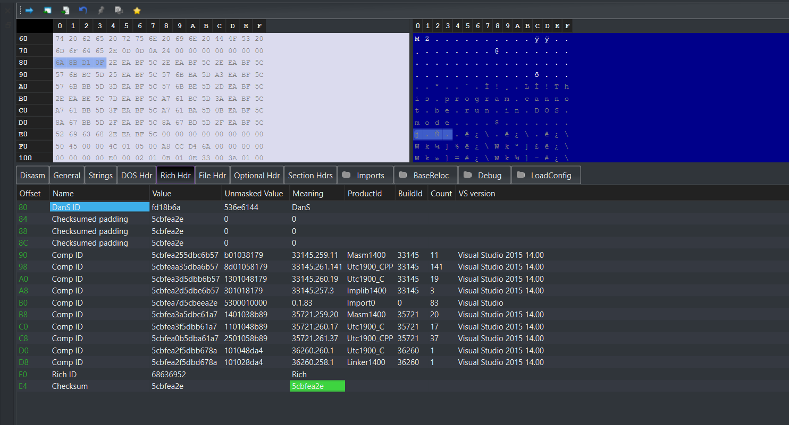

```
6A 8B D1 0F 2E EA BF 5C 2E EA BF 5C 2E EA BF 5C
57 6B BC 5D 25 EA BF 5C 57 6B BA 5D A3 EA BF 5C
57 6B BB 5D 3D EA BF 5C 57 6B BE 5D 2D EA BF 5C
2E EA BE 5C 7D EA BF 5C A7 61 BC 5D 3A EA BF 5C
A7 61 BB 5D 3F EA BF 5C A7 61 BA 5D 0B EA BF 5C
8A 67 BB 5D 2F EA BF 5C 8A 67 BD 5D 2F EA BF 5C
52 69 63 68 2E EA BF 5C 00 00 00 00 00 00 00 00
```

Trước khi được thực hiện phép XOR thì Rich Header có cấu trúc như sau:
- 4 byte đầu được gọi là DanS ID đóng vai trò như là dấu hiệu bắt đầu của Rich Header. Ta có thể gọi là DanS Signature.
- 12 byte tiếp theo là các byte 0 đóng vai trò như là padding.
- Tiếp đến là hàng loạt các chuỗi DWORD (4 byte) Comp ID. Với từng chuỗi DWORD này ta có cấu trúc như sau:
  - DWORD = WORD1 + WORD2, với WORD1 (tức 32 bit đầu) chứa thông tin về Product ID + Build ID, còn WORD2 (tức 32 bit cuối) sẽ chứa thông tin về Use Count.
  - Trong WORD1 thì cũng sẽ chia ra là hai phần với 16 bit đầu là chứa Product ID và 16 bit sau chứa Build ID. Về cơ bản thì Product ID là mã định danh công cụ, ví dụ compiler, linker hoặc công cụ xử lý thư viện. Build ID là số build của công cụ tương ứng. Count là số lượng thành phần đầu vào hoặc bản ghi build gắn với công cụ đó. Không nhất thiết là số lần người lập trình trực tiếp chạy công cụ.
- 4 byte sau đó là các byte `52 69 63 68`, tức là chữ `R i c h` đóng vai trò như là dấu mốc để kết thúc cả khối metadata mà ta đã nói ở trên. Đây cũng chính là lý do tại sao mà người ta gọi đây là Rich Header vì khi nhìn vào phần hex data của một file PE được tạo từ MSVC thì ta sẽ thấy rõ chữ `Rich` ở dạng ASCII mà không cần phải giải mã gì thêm. Còn đối với DanS là do nó đã bị XOR hoá nên tất cả các dữ liệu nằm trước Rich đều đã bị mã hoá sang dạng khác và chỉ có mỗi phần dữ liệu "Rich" này là không bị tính phép XOR. 
- 4 byte cuối cùng (các byte sau Rich) chính là XOR Key cho toàn bộ khối metadata ở trên, gọi là Checksum. Ta hoàn toàn có thể dùng chính key này để giải mã khối metadata ở trên và từ đó có thể trích xuất lại các thông tin như Product ID, Build ID và Count rồi (mặc dù khi dùng PE Bear thì nó cũng đã in sẵn cho ta :)

Có một điều khá là hay là làm sao các công cụ như PE Bear lại có thể dựa vào Product ID mà có thể biết được compiler, linker hay assembler, và nó thuộc phiên bản Visual Studio nào? Bởi vì trong Rich Header không lưu tên công cụ bằng chữ, mà chỉ lưu những con số. Để chuyển các giá trị số trong Rich Header thành tên và phiên bản công cụ thực tế, các nhà nghiên cứu phải thu thập và đối chiếu những giá trị này từ các bản cài đặt Visual Studio thật. Các nhà nghiên cứu thu thập thông tin từ những công cụ thuộc các phiên bản Visual Studio khác nhau, rồi xác định mã Product ID tương ứng với từng công cụ, từ đó xây dựng một bảng tra cứu. Khi PE-bear đọc Rich Header, nó lấy Product ID và tra cứu bảng này để hiển thị tên công cụ. Ta có thể xem cái bảng đó **[ở đây](https://github.com/hasherezade/bearparser/blob/master/parser/pe/RichHdrWrapper.cpp)**. 


Như vậy là ta đã tìm hiểu xong về phần đầu tiên của file PE. Ta có thể hiểu lại toàn bộ quá trình dựa trên dựa vào ảnh này:

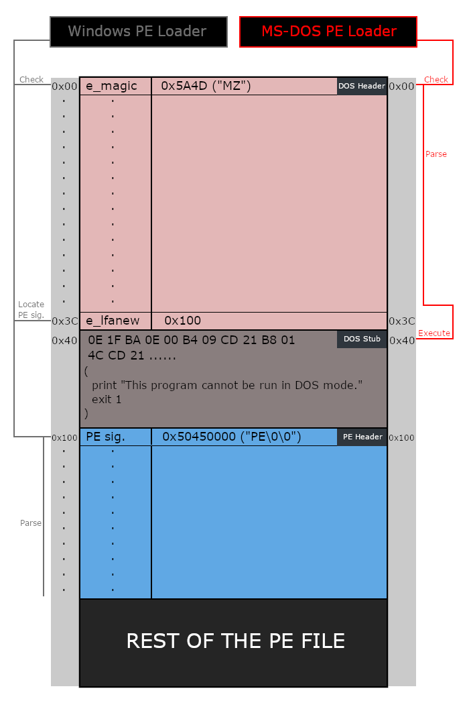


### PE Header (có thể gọi là NT Header)
Tiếp đến, sau phần DOS Header và các vùng dữ liệu liên quan, chúng ta sẽ tìm hiểu về **PE Header**, còn được gọi là NT Header. Đây là một trong những thành phần quan trọng nhất của cấu trúc file PE, chứa các thông tin cần thiết để Windows nhận diện, phân tích và nạp file PE vào bộ nhớ. Khác với DOS Header vốn có nguồn gốc từ thời MS-DOS, PE Header được sử dụng bởi bộ nạp chương trình (Windows PE Loader) trên các hệ điều hành Windows hiện đại. Vị trí bắt đầu của PE Header được xác định thông qua trường `e_lfanew` nằm trong `IMAGE_DOS_HEADER`. Tại vị trí này, chúng ta sẽ thấy 4 bytes `50 45 00 00`, tương ứng với chuỗi `PE\0\0`, được gọi là **PE Signature**.

Về mặt cấu trúc, PE Header bao gồm ba thành phần chính:

1. **PE Signature:** Chứa chữ ký `PE\0\0`, dùng để nhận diện định dạng PE.
2. **IMAGE_FILE_HEADER:** Chứa các thông tin cơ bản về file, chẳng hạn kiến trúc CPU mục tiêu, số lượng section và các thuộc tính của file.
3. **IMAGE_OPTIONAL_HEADER:** Chứa những thông tin quan trọng phục vụ quá trình nạp image, như địa chỉ entry point, image base, kích thước image và các data directory.

Như trong file `winnt.h` có định nghĩa struct của NT Header ở hai kiến trúc 32-bit và 64-bit như sau:
```c
typedef struct _IMAGE_NT_HEADERS64 {
    DWORD Signature;
    IMAGE_FILE_HEADER FileHeader;
    IMAGE_OPTIONAL_HEADER64 OptionalHeader;
} IMAGE_NT_HEADERS64, *PIMAGE_NT_HEADERS64;

typedef struct _IMAGE_NT_HEADERS {
    DWORD Signature;
    IMAGE_FILE_HEADER FileHeader;
    IMAGE_OPTIONAL_HEADER32 OptionalHeader;
} IMAGE_NT_HEADERS32, *PIMAGE_NT_HEADERS32;
```

Và ta có thể thấy vùng dữ liệu này bằng PE Bear như sau:

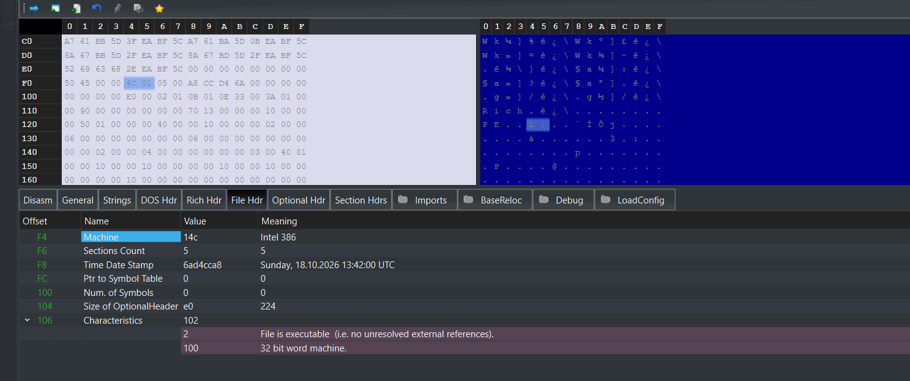

Trước khi đi vào tìm hiểu từng thành phần của PE Header thì ta cần phải biết một số thuật ngữ liên quan sau:
- VA (Virtual Address): là địa chỉ ảo khi chương trình được load vào bộ nhớ. Ví dụ khi load file vào IDA thấy địa chỉ hàm main() là 0x401000, thì đó là VA. Như này chẳng hạn:

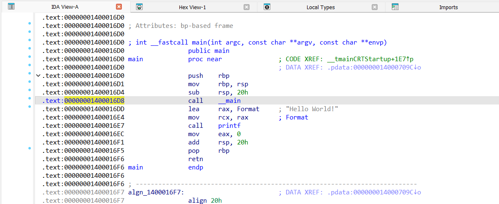

- Base Address: là địa chỉ cơ sở của chương trình khi nạp vào bộ nhớ. Thường có giá trị là 0x400000 trên Windows x86.

- RVA (Relative Virtual Address): là địa chỉ ảo tương đối của file, được tính toán như sau: RVA = VA - Base Address.

- IAT (Import Address Table): là 1 bảng sử dụng để lưu trữ địa chỉ của các API mà chương trình gọi trong lúc thực thi. Điều này giúp thuận tiện hơn trong quá trình trong việc quản lý, truy xuất, resolve, … các API so với việc địa chỉ được lưu 1 cách rời rạc.

- File Offset: là độ lệch tính theo byte của một vị trí dữ liệu so với điểm bắt đầu của file PE (offset 0). Nó được sử dụng để xác định vị trí của các thành phần như PE Headers, Section Headers và dữ liệu của các section trong cấu trúc file trên ổ đĩa. File Offset **không phải là địa chỉ bộ nhớ (Memory Address)** và cũng không phải là địa chỉ ảo (Virtual Address – VA) của dữ liệu khi PE được nạp vào bộ nhớ để thực thi. Khi PE được Windows Loader nạp vào bộ nhớ dưới dạng executable image, các vùng dữ liệu được ánh xạ dựa trên cấu trúc PE, trong đó RVA và VA được sử dụng để xác định vị trí của dữ liệu trong không gian địa chỉ ảo của tiến trình. Ta có công thức biểu thị mối quan hệ giữa File Offset, VA, RVA, PointerToRawData, VirtualAddress (dù nói là VirtualAddress nhưng thực tế nó là RVA của section) và ImageBase (Base Address) như sau:

    $$
    \text{RVA}=\text{File Offset}-\text{PointerToRawData}+\text{VirtualAddress}
    $$

    $$
    \text{VA}=\text{Base Address}+\text{RVA}
    $$

    Hay tương đương với:
    $$
    \text{VA}=\text{Base Address}+\text{File Offset}-\text{PointerToRawData}+\text{VirtualAddress}
    $$
#### Signature
Như đã giới thiệu ở phần DOS Header thì nó là phần giá trị hex `50 45 00 00` biểu diễn cho `PE\0\0` đóng vai trò làm chữ kí để hệ điều hành có thể xác định được đây là một file PE. Tuy nhiên, đây mới chỉ là một trong các bước xác thực file PE. Chữ ký hợp lệ không đảm bảo toàn bộ file hợp lệ hay có thể thực thi. Như trong `winnt.h` thì ta có định nghĩa của PE Signature như sau:
```c
#define IMAGE_NT_SIGNATURE                  0x00004550  // PE00
```


#### File Header
File Header, hay còn được gọi là COFF File Header vì nó có nguồn gốc từ định dạng COFF, thực chất là một struct chứa các thông tin được định nghĩa trong file `winnt.h` như sau:
```c
typedef struct _IMAGE_FILE_HEADER {
    WORD    Machine;
    WORD    NumberOfSections;
    DWORD   TimeDateStamp;
    DWORD   PointerToSymbolTable;
    DWORD   NumberOfSymbols;
    WORD    SizeOfOptionalHeader;
    WORD    Characteristics;
} IMAGE_FILE_HEADER, *PIMAGE_FILE_HEADER;
```

Nếu Signature giúp xác định định dạng PE thì FileHeader cung cấp những thông tin cơ bản về file, chẳng hạn:
- File dành cho CPU x86, x64 hay ARM64?
- File có bao nhiêu section?
- File có các đặc tính gì?
- Optional Header chiếm bao nhiêu bytes?

Với từng thành phần, ta có ý nghĩa và công dụng như sau:
- **Machine**: Dùng để xác định kiến trúc máy mà file được biên dịch để chạy. Ví dụ như trong ảnh này:

    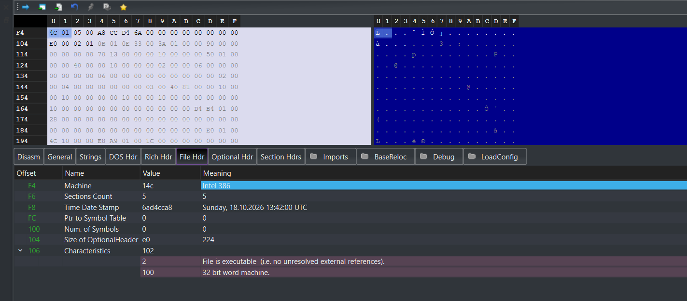
    
    thì ta có giá trị là `14c`, hay `0x014C` (little-endian) nhằm chỉ kiến trúc là Intel x86 đang được dùng để chạy. Và ngoài kiến trúc trên thì ta cũng sẽ có một số các kiến trúc khác, cụ thể hơn thì bạn có thể xem **[ở đây](https://learn.microsoft.com/en-us/windows/win32/debug/pe-format#machine-types)**.

- **NumberOfSections**: Dùng để lưu trữ số lượng section có trong file PE. Như hình này thì ta thấy có 5 section:

    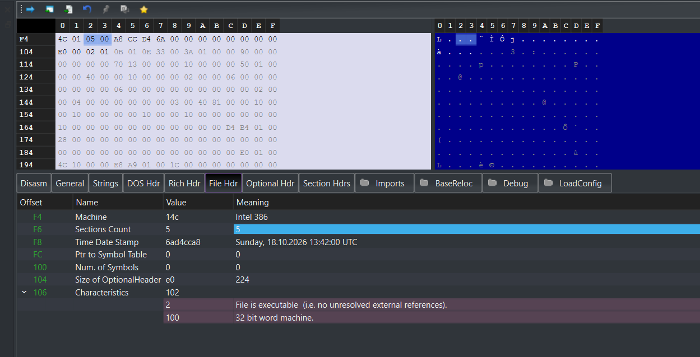

    Nói sơ qua một chút thì các section thông thường xuất hiện trong file PE bao gồm: `.text`, `.rdata`, `.data`, `.bss`, `rsrc`, `.reloc`. Cụ thể hơn thì ta sẽ tìm hiểu sau.

- **TimeDateStamp**: Được sử dụng để ghi lại thời điểm mà file PE được tạo hoặc chỉnh sửa. Điều này là quan trọng vì nó giúp xác định thời điểm cuối cùng khi file được biên dịch hoặc sửa đổi. Tuy nhiên ta cũng phải lưu ý rằng các hacker có thể thay đổi giá trị của trường này để làm cho quá trình phân tích tĩnh của file PE trở nên khó khăn hơn. Ví dụ:

    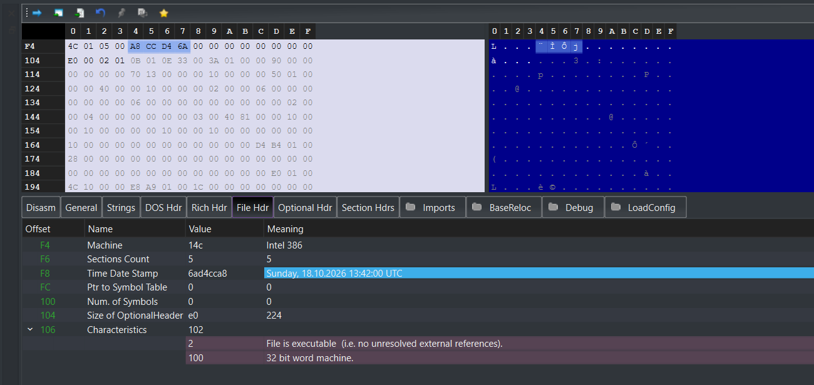

- **PointerToSymbolTable** và **NumberOfSymbols**: Hai trường thông tin này giữ offset của file chỉ đến COFF symbol table và số lượng entry trong symbol table đó. Tuy nhiên chúng được đặt giá trị là 0 có nghĩa là không có COFF symbol table. Điều này được thực hiện là do thông tin COFF debugging không được dùng nữa.

- **SizeOfOptionalHeader**: Được sử dụng để lưu trữ kích thước của section Optional Header. Do Optional Header không có kích thước cố định, thay vào đó, kích thước của nó có thể thay đổi tùy thuộc vào kiến trúc của các tệp tin PE khác nhau và theo các tính năng cụ thể mà tệp tin PE có hoặc không có.

- **Characteristics**: Với kích thước là 2 byte, trường này đại diện cho một số đặc tính của file PE. Ví dụ:

    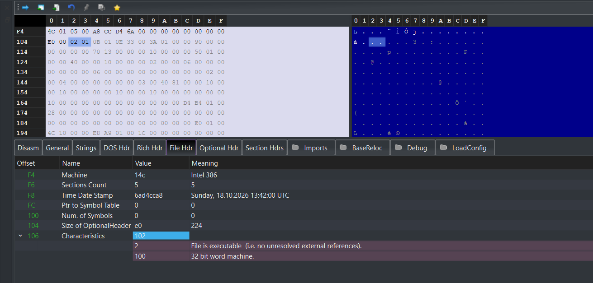

    Như trong ảnh trên thì ta biết được file này là một file có thể thực thi được. Ngoài ra, ta có thể sử dụng công cụ CFF Explorer để giúp xem tất cả các thuộc tính có thể xuất hiện như này:

    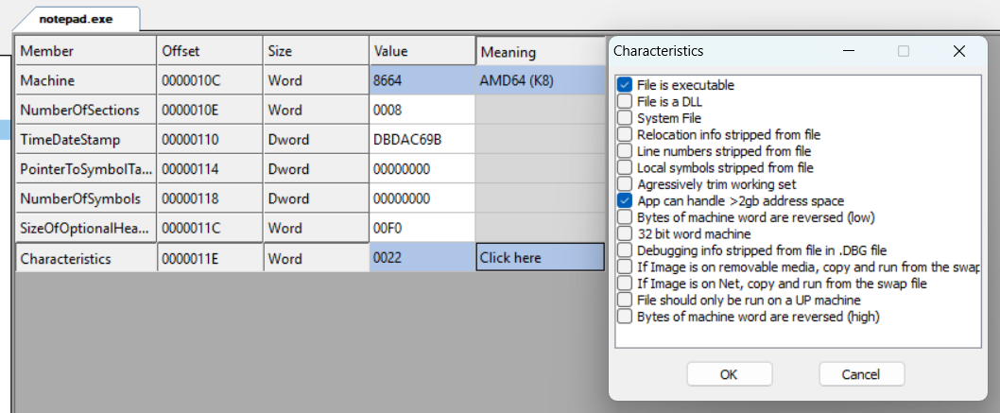

    Hoặc bạn có thể vào **[đây](https://learn.microsoft.com/en-us/windows/win32/debug/pe-format#characteristics)** để xem các đặc tính có thể có của file PE.


#### Optional Header
Optional Header là header quan trọng nhất của NT Header, PE Loader sẽ tìm kiếm thông tin cụ thể được cung cấp bởi header này để có thể tải và chạy tệp thực thi. Sở dĩ nó được gọi là Optional Header vì một số loại file như object file không có nó, tuy nhiên header này rất cần thiết cho các tệp hình ảnh. Nó không có kích thước cố định, đó là lý do tại sao mà ta có IMAGE_FILE_HEADER.SizeOfOptionalHeader như đã nói ở trên.

Về cơ bản thì Optional Header cũng là một struct được định nghĩa trong `winnt.h` như sau:
```c
typedef struct _IMAGE_OPTIONAL_HEADER {
    //
    // Standard fields.
    //

    WORD    Magic;
    BYTE    MajorLinkerVersion;
    BYTE    MinorLinkerVersion;
    DWORD   SizeOfCode;
    DWORD   SizeOfInitializedData;
    DWORD   SizeOfUninitializedData;
    DWORD   AddressOfEntryPoint;
    DWORD   BaseOfCode;
    DWORD   BaseOfData;

    //
    // NT additional fields.
    //

    DWORD   ImageBase;
    DWORD   SectionAlignment;
    DWORD   FileAlignment;
    WORD    MajorOperatingSystemVersion;
    WORD    MinorOperatingSystemVersion;
    WORD    MajorImageVersion;
    WORD    MinorImageVersion;
    WORD    MajorSubsystemVersion;
    WORD    MinorSubsystemVersion;
    DWORD   Win32VersionValue;
    DWORD   SizeOfImage;
    DWORD   SizeOfHeaders;
    DWORD   CheckSum;
    WORD    Subsystem;
    WORD    DllCharacteristics;
    DWORD   SizeOfStackReserve;
    DWORD   SizeOfStackCommit;
    DWORD   SizeOfHeapReserve;
    DWORD   SizeOfHeapCommit;
    DWORD   LoaderFlags;
    DWORD   NumberOfRvaAndSizes;
    IMAGE_DATA_DIRECTORY DataDirectory[IMAGE_NUMBEROF_DIRECTORY_ENTRIES];
} IMAGE_OPTIONAL_HEADER32, *PIMAGE_OPTIONAL_HEADER32;

typedef struct _IMAGE_OPTIONAL_HEADER64 {
    WORD        Magic;
    BYTE        MajorLinkerVersion;
    BYTE        MinorLinkerVersion;
    DWORD       SizeOfCode;
    DWORD       SizeOfInitializedData;
    DWORD       SizeOfUninitializedData;
    DWORD       AddressOfEntryPoint;
    DWORD       BaseOfCode;
    ULONGLONG   ImageBase;
    DWORD       SectionAlignment;
    DWORD       FileAlignment;
    WORD        MajorOperatingSystemVersion;
    WORD        MinorOperatingSystemVersion;
    WORD        MajorImageVersion;
    WORD        MinorImageVersion;
    WORD        MajorSubsystemVersion;
    WORD        MinorSubsystemVersion;
    DWORD       Win32VersionValue;
    DWORD       SizeOfImage;
    DWORD       SizeOfHeaders;
    DWORD       CheckSum;
    WORD        Subsystem;
    WORD        DllCharacteristics;
    ULONGLONG   SizeOfStackReserve;
    ULONGLONG   SizeOfStackCommit;
    ULONGLONG   SizeOfHeapReserve;
    ULONGLONG   SizeOfHeapCommit;
    DWORD       LoaderFlags;
    DWORD       NumberOfRvaAndSizes;
    IMAGE_DATA_DIRECTORY DataDirectory[IMAGE_NUMBEROF_DIRECTORY_ENTRIES];
} IMAGE_OPTIONAL_HEADER64, *PIMAGE_OPTIONAL_HEADER64;
```

Hay như trong PE Bear thì ta sẽ có:

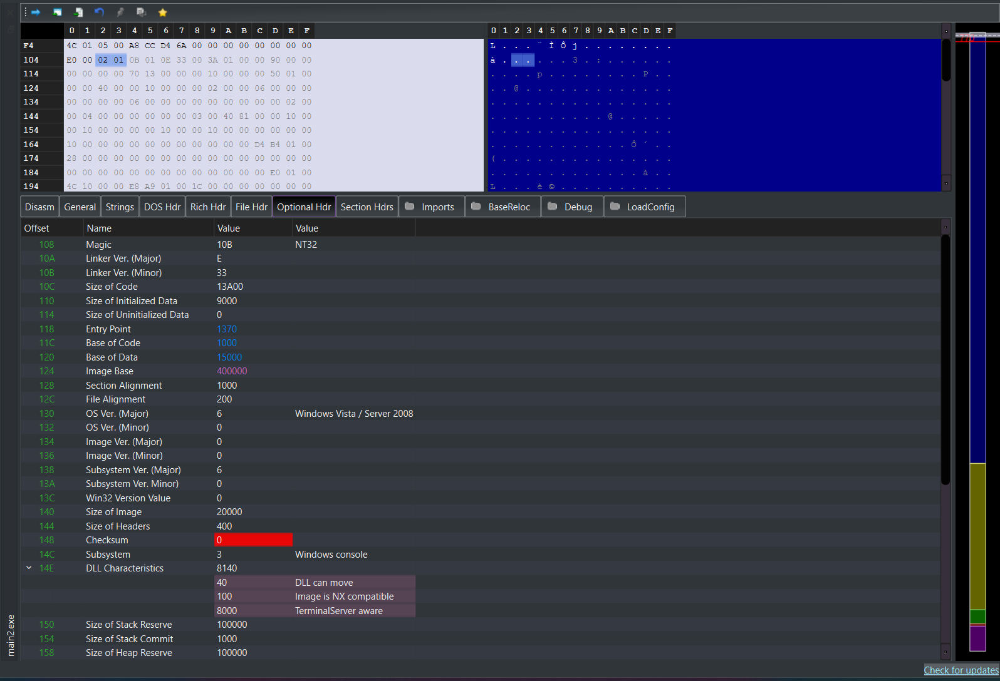
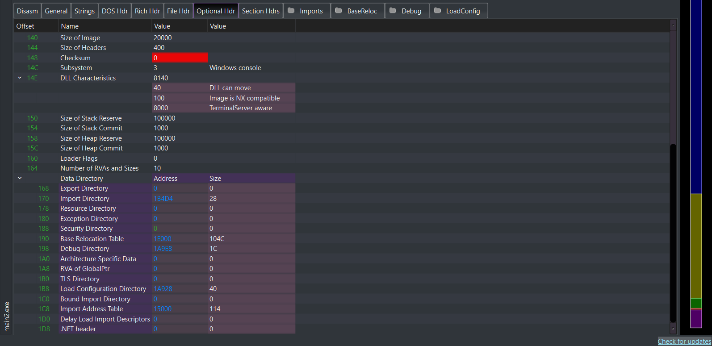

Dù chứa nhiều thành phần như vậy nhưng thực tế ta có thể gom tất cả các thành phần nằm trong Optional Header ở trên vào ba trường chính:
- Standard Fields:
    - **Magic**: Đây là kiểu số nguyên để xác định định dạng của Optional Header, từ đó giúp Windows PE Loader biết cách diễn giải những thông tin tiếp theo trong header. Phổ biến nhất là `0x10B` để xác định file PE32 (file PE 32-bit) và `0x20B` cho file PE32+ (tức file PE 64-bit). Ngoài ra ta có một số giá trị khác như `0x107` nhằm xác định đây là định dạng ROM Image, hiếm gặp trong các PE thông thường.

    - **MajorLinkerVersion** và **MinorLinkerVersion**: Cho biết phiên bản linker được ghi vào file. Hai giá trị này có thể hữu ích khi phân tích dấu vết công cụ build, nhưng không đảm bảo xác định chính xác compiler hay toàn bộ toolchain.

    - **SizeOfCode**: Tổng kích thước phần code được khai báo.

    - **SizeOfInitializedData**: Tổng kích thước dữ liệu đã khởi tạo.

    - **SizeOfUninitializedData**: Tổng kích thước dữ liệu chưa khởi tạo.

    - **AddressOfEntryPoint**: Kích thước 4 byte. Đây là một trong những trường quan trọng nhất của toàn bộ PE Header vì nó là RVA của điểm vào được khai báo trong PE Header. Đây là vị trí Windows Loader chuyển quyền điều khiển tới sau những công việc khởi tạo cần thiết, nhưng không nhất thiết là đoạn code đầu tiên được thực thi trong quá trình khởi tạo process.

    - **BaseOfCode**: Chứa địa chỉ RVA của phần code (2 giá trị BaseOfCode và AddressOfEntryPoint có thể giống nhau nếu phần địa chỉ bắt đầu của mã thực thi và địa chỉ bắt đầu của vùng nhớ mã thực thi trùng nhau).

    - **BaseOfData**: Tương tự với BaseOfCode, nó cũng sẽ chứa RVA của phần Data khi file PE được nạp vào bộ nhớ. Một điều khá là hay là trong struct Optional Header của PE32+ thì sẽ không có trường BaseOfData. Việc PE32+ không có BaseOfData không có nghĩa là chương trình 64-bit không có vùng data. Các vùng dữ liệu vẫn được mô tả thông qua Section Header và những cấu trúc PE khác. 

- Windows-Specific Fields:
    - **ImageBase**: Là địa chỉ nạp được ưu tiên cho PE file. Đối với Windows 32-bit truyền thống thì hầu như giá trị này là `0x00400000`, còn 64-bit là `0x140000000`. Khi đó, PE Loader sẽ cố gắng cấp phát không gian trong bộ nhớ ảo để sao chép file PE và các section của nó vào trong, bắt đầu tại `0x00400000`. Ưu tiên ở đây không thể nạp file tại địa chỉ đó nếu như có một module nào khác đã chiếm giữ vùng địa chỉ này. Có thể giải thích rằng do trong quá trình tạo một process hoàn chỉnh, không chỉ Windows loader nạp module tương ứng với file PE mà còn phải nạp các module khác, chẳng hạn như DLL và mapped file,... Điều này làm cho địa chỉ `0x00400000` có thể đã được sử dụng bởi một module khác, khiến cho Windows loader phải tìm một vị trí khác để nạp file PE lên. Ta có thể hiểu đơn giản ImageBase sẽ chứa địa chỉ mà file PE mong muốn được nạp vào đó. Giả sử nếu mọi chuyện thuận lợi như việc `0x00400000` đang không chứa giá trị nào đó thì khi đó nó sẽ chứa file offset 0x00 của file PE là MZ Signature (cụ thể là chứa ký tự M). Sau khi nạp image vào địa chỉ mới, loader sẽ thực hiện một quá trình gọi là relocation (tái định vị), trong đó nó điều chỉnh các địa chỉ tuyệt đối được tham chiếu bên trong image để chúng hoạt động chính xác với ImageBase mới. Có một section đặc biệt lưu trữ thông tin về những vị trí cần được điều chỉnh khi quá trình relocation diễn ra. Section này được gọi là relocation section (.reloc). Ngoài ra, Windows còn có cơ chế ASLR (Address Space Layout Randomization), cho phép hệ điều hành chọn ngẫu nhiên địa chỉ nạp của image để làm việc khai thác lỗ hổng khó dự đoán hơn.

    - **SectionAlignment**: dùng để quy định đơn vị căn chỉnh vị trí bắt đầu của các section khi PE được ánh xạ vào bộ nhớ ảo (Virtual Memory). Nói đơn giản thì nó có vai trò quyết định các section như .text, .data, .rdata sẽ được bố trí tại những RVA như thế nào khi chương trình được nạp vào bộ nhớ. Thông thường, với các PE được biên dịch bằng MSVC thì SectionAlignment sẽ bằng `0x1000`, hay 4096 byte cũng là kích thước trang bộ nhớ (Memory Page) thông dụng trên Windows x86/x64. Ví dụ với `SectionAlignment = 0x1000` và trong file PE lúc đó đang có 3 section là `.text`, `.data`, `.rdata` chẳng hạn, thì khi đó các section thường bắt đầu tại những RVA là bội số của 0x1000. Tuy nhiên điều đó không có nghĩa mỗi section chỉ được phép có kích thước 0x1000 byte. Một section có thể lớn hơn nhiều trang bộ nhớ. Giả sử như section `.text` có kích thước là `0x650` byte và nó bắt đầu tại RVA là `0x1000` thì theo lý thuyết phần dữ liệu logic của nó kết thúc ở `0x1000 + 0x650 = 0x1650` Khi này, các section tiếp theo ví dụ như `.data` sẽ không bắt đầu tại RVA `0x1650` đó. Lý do là bởi vì ta đã quy định ngay từ đầu là RVA của các section là bội số của `0x1000`. Do đó, RVA bắt đầu của section tiếp theo được căn chỉnh lên bội số phù hợp của 0x1000. Điều này cũng hỗ trợ Windows quản lý các vùng nhớ và quyền truy cập theo trang, chẳng hạn trang chứa code có quyền Execute, còn trang dữ liệu có quyền Write. Ta có công thức căn chỉnh của `SectionAlignment` như sau:
    $$\text{AlignUp}(x, a)=\lceil\frac{x}{a}\rceil\times a$$

    - **FileAlignment**: Cũng giống như SectionAlignment, FileAlignment dùng để quy định đơn vị căn chỉnh dữ liệu của các section khi chúng được lưu trong file trên ổ đĩa (Disk). Nếu SectionAlignment quy định cách căn chỉnh section trong bộ nhớ ảo thì FileAlignment quy định cách căn chỉnh section trong file PE trên ổ đĩa. Vẫn là ví dụ đó, giả sử vùng text có kích thước là `0x650` byte và FileAlignment = 0x200 thì khi này 0x650 không phải là bội của 0x200 nên linker có thể thêm các byte padding để kích thước dữ liệu section trên đĩa được căn chỉnh thành 0x800. Ngoài ra, ta sẽ không thể sửa FileAlignment thành một giá trị bất kì nào khác. Theo đặc tả PE thông thường, FileAlignment phải là lũy thừa của 2 và nằm trong khoảng 512 đến 65536 byte. Thêm nữa là SectionAlignment >= FileAlignment.

    - **MajorOperatingSystemVersion, MinorOperatingSystemVersion, MajorImageVersion, MinorImageVersion, MajorSubsystemVersion and MinorSubsystemVersion**: Các thành viên này của cấu trúc lần lượt chỉ định số phiên bản chính (major version number) của hệ điều hành được yêu cầu, số phiên bản phụ (minor version number) của hệ điều hành được yêu cầu, số phiên bản chính của image, số phiên bản phụ của image, số phiên bản chính của subsystem và số phiên bản phụ của subsystem.

    - **Win32VersionValue**: Trường được dành riêng, bắt buộc phải có giá trị bằng 0. Ta có hiểu đơn giản đây là trường dành riêng (reserved field). Đặc tả PE không quy định một ý nghĩa sử dụng thông thường cho trường này trong định dạng hiện tại. Tên Win32VersionValue dễ khiến ta hiểu nhầm rằng nó lưu phiên bản Windows mà chương trình yêu cầu, nhưng thực tế không phải vậy.
    
    - **SizeOfImage**: Toàn bộ kích thước của PE image trong bộ nhớ. Nó là tổng tất cả các headers và sections được liên kết tới Section Alignment. Lưu ý rằng độ lớn của module tương ứng với file PE khi nó được ánh xạ vào bộ nhớ của process sẽ khác với kích thước của file PE trên đĩa. Giá trị này phải là bội số của SectionAlignment. Ví dụ ta có ImageBase = `0x140000000`, với SizeOfImage = `0x20000` thì điều đó có nghĩa là vùng địa chỉ của image trải dài từ `0x140000000 -> 0x14001FFFF`, tổng cộng là `0x20000 = 131072 byte = 128 KiB`

    - **SizeOfHeader**: là kích thước của toàn bộ vùng header trong file PE, bao gồm DOS Header, DOS Stub và các dữ liệu header liên quan, NT Headers và Section Table, được làm tròn lên theo FileAlignment.

    - CheckSum: Là giá trị mà Windows có thể sử dụng để kiểm tra tính nhất quán của image trong một số trường hợp. Lưu ý là checksum không phải cơ chế bảo mật mật mã học. Nó không bảo đảm file không bị sửa đổi có chủ đích.

    - Subsystem: Dùng để xác định môi trường thực thi mà file PE được thiết kế để chạy trong đó. Nói đơn giản, nó giúp Windows biết chương trình thuộc loại nào, chẳng hạn ứng dụng giao diện đồ họa hay chương trình chạy trong console. Ta có thể xem các giá trị của Subsystem ứng với chương trình nào **[ở đây](https://learn.microsoft.com/en-us/windows/win32/debug/pe-format#windows-subsystem)**.

    - DLLCharacteristics: Trường này xác định một số đặc tính của file thực thi (executable image file), chẳng hạn như file có tương thích với cơ chế NX hay không và có thể được tái định vị (relocated) trong thời gian chạy hay không. Nó vẫn tồn tại trong các file thực thi thông thường (.exe) và xác định những đặc tính cũng có thể áp dụng cho các file thực thi thông thường đó. Chi tiết hơn thì bạn có thể xem **[ở đây](https://learn.microsoft.com/en-us/windows/win32/debug/pe-format#dll-characteristics)**

    - SizeOfStackReserve, SizeOfStackCommit, SizeOfHeapReserve and SizeOfHeapCommit: Các trường này lần lượt chỉ định kích thước vùng stack cần dành trước (reserve), kích thước vùng stack cần cấp phát bộ nhớ thực tế ban đầu (commit), kích thước vùng heap cục bộ cần dành trước (reserve) và kích thước vùng heap cục bộ cần cấp phát bộ nhớ thực tế ban đầu (commit).

    - LoaderFlags: Tương tự với Win32VersionValue, trường được dành riêng, bắt buộc phải có giá trị bằng 0.

    - **NumberOfRvaAndSizes**: Có nhiệm vụ cho biết có bao nhiêu mục Data Directory được khai báo trong Optional Header, hay nói cách khác là cho biết kích thước của mảng DataDirectory. 


- Data Directories: Đây là thành viên cuối cùng của Optional Header. Đây là một bảng gồm các mục mô tả vị trí và kích thước của những cấu trúc dữ liệu quan trọng bên trong file PE hoặc image PE đã được nạp vào bộ nhớ. Nó giúp Windows Loader và các công cụ phân tích PE biết cần tìm ở đâu để xử lý những thành phần như bảng Import, bảng Export, tài nguyên (Resources), thông tin Relocation và nhiều cấu trúc khác. Data Directory không trực tiếp chứa toàn bộ dữ liệu của các thành phần đó. Nó chủ yếu chứa thông tin cho biết dữ liệu nằm ở đâu và có kích thước bao nhiêu. Về cơ bản thì Data Directories là một struct được định nghĩa trong `winnt.h` như sau:

```c
IMAGE_DATA_DIRECTORY DataDirectory[IMAGE_NUMBEROF_DIRECTORY_ENTRIES];
```

`IMAGE_NUMBEROF_DIRECTORY_ENTRIES` ở đây là một hằng số được định nghĩa trước đó là 16, điều đó có nghĩa là mảng này có thể có lên tới 16 phần tử `IMAGE_DATA_DIRECTORY` được định nghĩa như là một struct như sau:

```c
typedef struct _IMAGE_DATA_DIRECTORY {
    DWORD   VirtualAddress;
    DWORD   Size;
} IMAGE_DATA_DIRECTORY, *PIMAGE_DATA_DIRECTORY;
```

Thực tế thì nó là một mảng gồm 16 mục trong PE Header (128 byte cuối của OptionalHeader) mỗi mục chứa RVA và kích thước của một bảng dữ liệu quan trọng như Import/Export/Resource Directory và cả IAT(Import Address Table). Nếu một mục không tồn tại, cả hai giá trị sẽ là 0. Data Directory giúp hệ điều hành định vị và nạp các thành phần của PE file. Định nghĩa trong `winnt.h` ta có:
```c
// Directory Entries

#define IMAGE_DIRECTORY_ENTRY_EXPORT          0   // Export Directory
#define IMAGE_DIRECTORY_ENTRY_IMPORT          1   // Import Directory
#define IMAGE_DIRECTORY_ENTRY_RESOURCE        2   // Resource Directory
#define IMAGE_DIRECTORY_ENTRY_EXCEPTION       3   // Exception Directory
#define IMAGE_DIRECTORY_ENTRY_SECURITY        4   // Security Directory
#define IMAGE_DIRECTORY_ENTRY_BASERELOC       5   // Base Relocation Table
#define IMAGE_DIRECTORY_ENTRY_DEBUG           6   // Debug Directory
//      IMAGE_DIRECTORY_ENTRY_COPYRIGHT       7   // (X86 usage)
#define IMAGE_DIRECTORY_ENTRY_ARCHITECTURE    7   // Architecture Specific Data
#define IMAGE_DIRECTORY_ENTRY_GLOBALPTR       8   // RVA of GP
#define IMAGE_DIRECTORY_ENTRY_TLS             9   // TLS Directory
#define IMAGE_DIRECTORY_ENTRY_LOAD_CONFIG    10   // Load Configuration Directory
#define IMAGE_DIRECTORY_ENTRY_BOUND_IMPORT   11   // Bound Import Directory in headers
#define IMAGE_DIRECTORY_ENTRY_IAT            12   // Import Address Table
#define IMAGE_DIRECTORY_ENTRY_DELAY_IMPORT   13   // Delay Load Import Descriptors
#define IMAGE_DIRECTORY_ENTRY_COM_DESCRIPTOR 14   // COM Runtime descriptor
```

Ta có xem phân vùng này bằng PE Bear như sau:

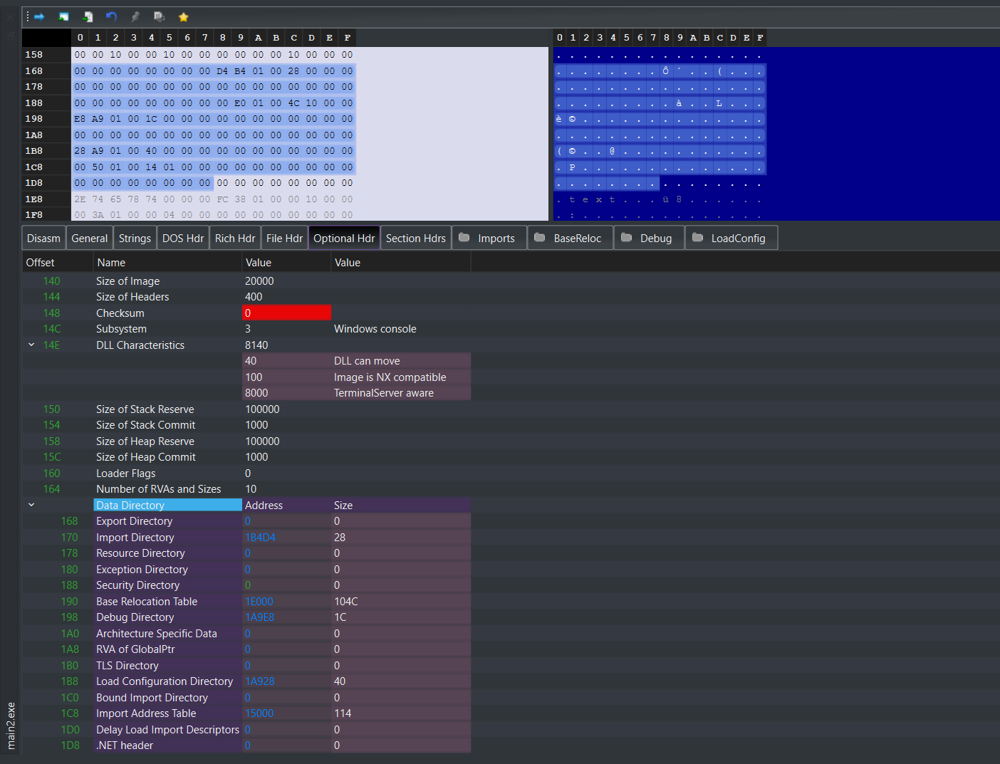

Cần phải lưu ý rằng không phải mọi file PE đều khai báo đủ 16 mục. Khi đọc một file, phải kiểm tra NumberOfRvaAndSizes và kích thước thực tế của Optional Header trước khi truy cập một mục cụ thể. Các mục không được sử dụng trong một file thường có VirtualAddress = 0 và Size = 0. Không có nghĩa là file PE đó bị lỗi.

### Section và Section Header
Tiếp đến sau phần PE Header thì nó sẽ là Section. Nghe tên thì chắc chúng ta cũng đoán được ý nghĩa và tầm quan trọng của thành phần này. Nó là 1 structure, mà mỗi phần tử sẽ chứa thông tin về một section trong PE file. Từ đó Windows loader mới xác định được vị trí của các section trong file PE rồi mới có thể biết được nên nạp các section vào những vị trí cụ thể nào trên bộ nhớ. Các section thường thấy trên một file PE có thể kể đến như:
- `.text`: Chứa các đoạn mã thực thi của chương trình.
- `.data`: Chứa các dữ liệu đã được khởi tạo giá trị.
- `.bss`:  Chứa các dữ liệu chưa được khởi tạo giá trị.
- `.rdata`: Chứa các dữ liệu đã được khởi tạo giá trị với quyền là chỉ có thể đọc.
- `.edata`: Chứa thông tin về những hàm và dữ liệu mà file PE cung cấp cho module khác sử dụng.
- `.idata`: Chứa thông tin về những hàm và dữ liệu mà file PE nhập từ module khác.
- `.reloc`: Chứa thông tin về relocation, là những thông tin cần thiết để thực hiện thay đổi base address của 1 module khi nó được nạp vào bộ nhớ (hay còn gọi là tái định vị). Cái này quan trọng vì nó đảm bảo các địa chỉ trong chương trình là chính xác và đúng với địa chỉ bộ nhớ của chương trình đang chạy. Tức là đảm bảo việc không xảy ra xung đột địa chỉ khi nạp hoặc lỗi tham chiếu,...
- `.rsrc`: Chứa tài nguyên được dùng bởi chương trình, bao gồm ảnh, icon hay thậm chí các mã nhị phân được nhúng.
- `.tls`: (Thread Local Storage), cung cấp bộ nhớ riêng cho mỗi luồng thực thi của chương trình.

Tên section chỉ là quy ước, không phải thứ duy nhất quyết định nội dung hoặc quyền truy cập, nhưng về cơ bản có thể nói đây là các section chứa nội dung chính của file, gồm .code, .data,... nằm sau Section Header và cũng chính là phần còn lại của file PE. Mỗi section có một Header và một Body. Tuy nhiên những Section Body lại không có cấu trúc, chúng có thể được sắp xếp theo bất kì cách nào với điều kiện là Header chứa đầy đủ thông tin để có thể giải mã dữ liệu.

Tiếp theo là với Section Header. Thực tế thì Section Header sẽ nằm ở trên Section và nằm ngay dưới Optional Header. Nó là một struct được định nghĩa như sau:
```c
#define IMAGE_SIZEOF_SHORT_NAME              8

typedef struct _IMAGE_SECTION_HEADER {
    BYTE    Name[IMAGE_SIZEOF_SHORT_NAME];
    union {
            DWORD   PhysicalAddress;
            DWORD   VirtualSize;
    } Misc;
    DWORD   VirtualAddress;
    DWORD   SizeOfRawData;
    DWORD   PointerToRawData;
    DWORD   PointerToRelocations;
    DWORD   PointerToLinenumbers;
    WORD    NumberOfRelocations;
    WORD    NumberOfLinenumbers;
    DWORD   Characteristics;
} IMAGE_SECTION_HEADER, *PIMAGE_SECTION_HEADER;
```
Ta sẽ phân tích từng phần ở đây như sau:
- **Name**: Đây là trường đầu tiên của struct này có kích thước là 8 byte (mảng có 8 phần tử hoặc chuỗi có 8 ký tự). Vai trò của trường này là lưu tên section. Vậy nên tên của section không cần kết thúc bằng null và có thể để trống, tối đa thì 8 ký tự.

- **VirtualSize**: là tổng kích thước theo byte của section trên không gian địa chỉ ảo của process. Nếu như `VirtualSize >= SizeOfRawData` thì hệ điều hành sẽ padding các byte 0 vào sao cho bằng với VirtualSize.

- **VirtualAddress**: là RVA của byte đầu tiên trong section. Với file .exe hoặc .dll đã liên kết, Microsoft định nghĩa trường này là địa chỉ của byte đầu tiên trong section, tương đối với Image Base khi image được nạp vào bộ nhớ. Nói cách khác, đây là RVA của section. Lưu ý là VirtualAddress không phải file offset. Nếu muốn xác định vị trí dữ liệu section trên đĩa thì ta cần dùng PointerToRawData.

- **SizeOfRawData** và **PointerToRawData**: Lần lượt là kích thước các section trên file và file offset của section tính từ đầu file PE trên đĩa.

- **PointerToRelocations** và **NumberOfRelocations**: File offset trỏ đến vị trí bắt đầu của bảng relocation entries dành cho section trong file COFF và số lượng relocation entries trong bảng đó. Khi compiler biên dịch mã nguồn thành file .obj, nó có thể chưa biết địa chỉ cuối cùng của một hàm hoặc biến nằm ở đâu. Vì vậy, compiler tạo ra các relocation entries để linker biết vị trí nào cần chỉnh sửa khi liên kết các object files thành chương trình hoàn chỉnh.

- **PointerToLinenumbers** và **NumberOfLinenumbers**: File offset trỏ đến bảng line-number entries gắn với section và số lượng entries trong bảng đó. Vậy Linenumber là gì? Đây là thông tin ánh xạ giữa vị trí trong mã máy và số dòng trong mã nguồn, được dùng bởi một số định dạng thông tin debug cũ. Thông tin line-number có thể giúp debugger liên hệ một địa chỉ trong mã máy với dòng 2 của file nguồn, hỗ trợ đặt breakpoint hoặc hiển thị vị trí thực thi.

- **Characteristics**: Trường này giúp xác định các đặc tính của một section như executable code, initialized data, uninitialized data, read, write,... Nó được dùng như một tập hợp các cờ bit (bit flags), chứ không phải một giá trị đơn giản chỉ có một ý nghĩa. Ví dụ như ảnh này:

    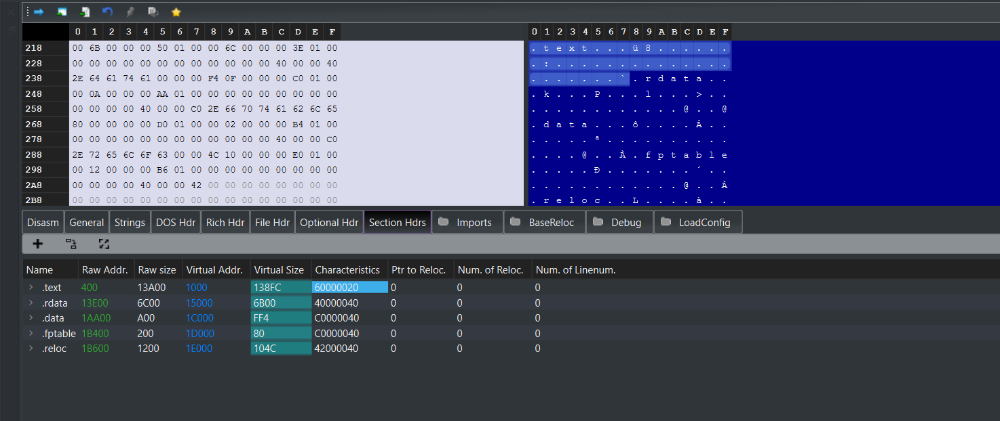

    Ở đây ta có section `.text` có characteristics là `0x60000020 = 0x20000000 + 0x40000000 + 0x00000020`. Với `0x20000000` là mã cho biết section này có thể thực thi được mã lệnh, `0x40000000` là đại diện cho việc section này có thể đọc được và `0x00000020` cho biết section này được dùng để chứa mã lệnh. Còn nhiều các loại mã khác với các vai trò khác nhau, bạn có thể xem chi tiết **[ở đây](https://learn.microsoft.com/en-us/windows/win32/debug/pe-format#section-flags)**.


## PE Import
PE Import là cơ chế cho phép một file PE (Portable Executable) trên Windows sử dụng các hàm được cung cấp bởi những DLL (Dynamic Link Library) bên ngoài, thay vì phải chứa toàn bộ mã nguồn máy của các hàm đó trong chính file PE. Ta có thể hiểu cơ bản nó là khi chương trình cần sử dụng các hàm từ các thư viện bên ngoài như DLL thì nó khai báo những hàm bên ngoài mà nó cần sử dụng.

Giả sử ta có một code C như này:
```c
#include <windows.h>
int main()
{
    MessageBoxA(
        NULL,
        "Flag: flag{Hello_from_WinAPI!}",
        "This is your gift",
        MB_OK
    );

    return 0;
}
```

Chương trình này sử dụng hàm MessageBoxA, nhưng mã máy thực hiện chức năng hiển thị hộp thoại không nằm trực tiếp trong file EXE của chúng ta. Thay vào đó, file PE lưu thông tin đủ để Windows Loader biết:
- Chương trình cần DLL nào?
- Cần những hàm nào từ DLL đó?
- Thông tin tên hàm hoặc ordinal nằm ở đâu?
- Sau khi tìm được hàm, địa chỉ của hàm phải được ghi vào đâu?


## Cơ chế PE Loading trên Windows
PE Loading là quá trình Windows đưa một file Portable Executable (.exe, .dll, ...) từ ổ đĩa vào không gian địa chỉ ảo của một tiến trình, thiết lập những thành phần cần thiết để thực thi và cuối cùng chuyển quyền điều khiển đến điểm bắt đầu của chương trình. Điều quan trọng là Windows không đơn giản đọc toàn bộ file .exe rồi sao chép nguyên xi vào RAM để thực thi. Thay vào đó, hệ điều hành sử dụng cơ chế memory mapping, tổ chức lại các section theo RVA, thực hiện relocation khi cần, xử lý DLL dependencies, import và khởi tạo môi trường chạy.

Giả sử ta có một code C như này:
```c
#include <windows.h>
int main()
{
    MessageBoxA(
        NULL,
        "Flag: flag{Hello_from_WinAPI!}",
        "This is your gift",
        MB_OK
    );

    return 0;
}
```

Sau khi biên dịch ta được một file `test.exe` chẳng hạn, thì khi mở file đó, một tiến trình khác (chẳng hạn Explorer hoặc terminal) yêu cầu Windows tạo process mới. Ta có thể hiểu một cách đơn giản về quá trình tạo process thông qua sơ đồ sau:
```
CreateProcessW()
      |
      v
Win32 process-creation routines
      |
      v
NtCreateUserProcess()
      |
      v
Windows Kernel
      |
      +--> Tạo Process Object (EPROCESS)
      |
      +--> Tạo Thread Object (ETHREAD)
      |
      +--> Chuẩn bị không gian địa chỉ ảo
      |
      +--> Tạo / map executable image
      |
      +--> Thiết lập PEB, TEB, Stack
```
trong đó:
- `EPROCESS`: Cấu trúc trong kernel biểu diễn tiến trình
- `ETHREAD`: Cấu trúc trong kernel biểu diễn thread
- `PEB`: Process Environment Block, chứa thông tin về process ở user mode
- `TEB`: Thread Environment Block, chứa thông tin riêng của từng thread
- `Stack`: Vùng nhớ phục vụ lời gọi hàm và dữ liệu cục bộ

Tại thời điểm này, process đã được tạo ra, nhưng điều đó không có nghĩa là hàm main() đã chạy. Khi này, Windows sẽ phân tích từng thành phần trong file PE `test.exe` vừa mới được biên dịch xong. Trước khi ánh xạ image vào vùng nhớ ảo để thực thi, Windows cần kiểm tra tính hợp lệ của định dạng PE và đọc các metadata cần thiết ví dụ như kiểm tra tính hợp lệ của file bằng MZ Signature, PE Signature, ImageBase, SizeOfImage, AddressOfEntryPoint,... Sau khi đã kiểm tra và xác thực tính hợp lệ của từng thành phần trong file PE đó rồi thì hệ thống sẽ bắt đầu mapping PE vào vùng nhớ ảo. 

Giả sử `test.exe` có những thông số như thế này đi:

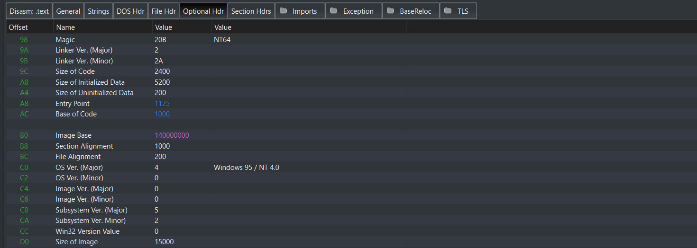
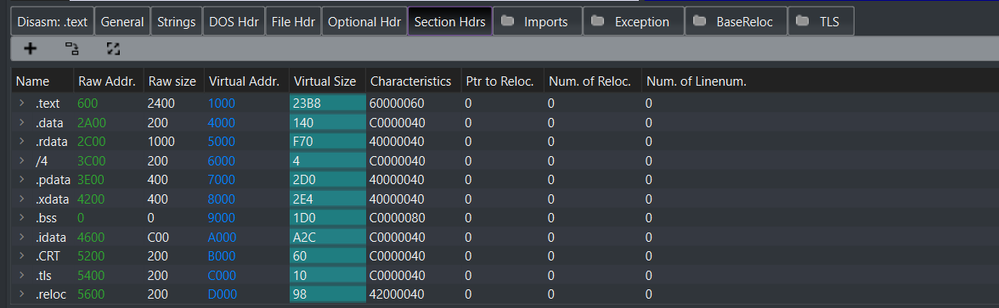

Như là:
```
- ImageBase          = 0x140000000
- SizeOfImage        = 0x15000
- SizeOfHeaders      = 0x600
- SectionAlignment   = 0x1000
- FileAlignment      = 0x200

Section         PointerToRawData        VirtualAddress (RVA)
.text	             0x600	                 0x1000
.rdata	             0x2C00	                 0x5000
.data	             0x2A00                  0x4000
.idata	             0x4600                  0xA000
.reloc	             0x5600                  0xD000
```

Giả sử Windows ánh xạ image đúng tại preferred ImageBase = 0x140000000. Khi đó:
- .text bắt đầu tại 0x140000600.
- .rdata bắt đầu tại 0x140002C00.
- .data bắt đầu tại 00x14002A00.

Cứ như thế mà load vào vùng nhớ ảo. Ngoài ra, Windows còn áp dụng quyền bảo vệ cho các vùng bộ nhớ dựa trên đặc tính của image. Ví dụ như vùng .text thì chỉ có quyền đọc và thực thi. Nếu CPU thực hiện một thao tác ghi vào trang chỉ có quyền Read + Execute, Windows có thể phát sinh access violation.

Và sau khi đã load các section của file PE đó vào trong bộ nhớ ảo thì Windows còn có một thao tác nữa là Base Relocation. Nói một cách dễ hiểu đây là bước liên quan trực tiếp đến ASLR (Address Space Layout Randomization). Như đã nói ở trên thì ImageBase chứa địa chỉ mà file mong muốn sẽ ghi vào đó (như trong ví dụ hiện tại là `0x140000000`). Tuy nhiên, nếu như cơ chế ASLR được kích hoạt thì image sẽ được ánh xạ sang vùng địa chỉ khác, chẳng hạn:
```
Preferred ImageBase = 0x140000000
Actual ImageBase    = 0x7FF6E0340000
```

Độ chênh lệch sẽ là:
$$
\Delta=\text{Actual ImageBase}-\text{Preferred ImageBase}
$$

Nếu trong image có một con trỏ tuyệt đối ban đầu chứa `0x140003000` thì con trỏ đó cần trỏ tới địa chỉ tương ứng ở vị trí mới `0x7FF6E0343000`. Đó là nhiệm vụ của Base Relocation. Windows sử dụng thông tin từ Base Relocation Directory (thường lưu trong .reloc) để xác định những vị trí phải được điều chỉnh. Điều quan trọng là Không phải mọi giá trị địa chỉ trong PE đều cần relocation. Trên x64, rất nhiều lệnh sử dụng RIP-relative addressing nên không cần sửa khi image bị di chuyển. Relocation chủ yếu áp dụng tại những vị trí được linker đánh dấu phù hợp.

Tiếp đến là load DLL và resolve imports. Như trong đoạn code C ở trên thì ta đang gọi một hàm của Windows là MessageBoxA. Trên thực tế thì hàm MessageBoxA được export bởi user32.dll, không nằm trong mã nguồn của `test.exe`. Cũng giống như các hàm khác trong một chương trình đang được thực thi thì ta cần phải biết được địa chỉ của hàm đó nằm ở đâu để mà có thể nhảy tới đó mà thực thi. Tương tự để thực thi thành công, Windows phải xác định địa chỉ thực tế của hàm trong process. 